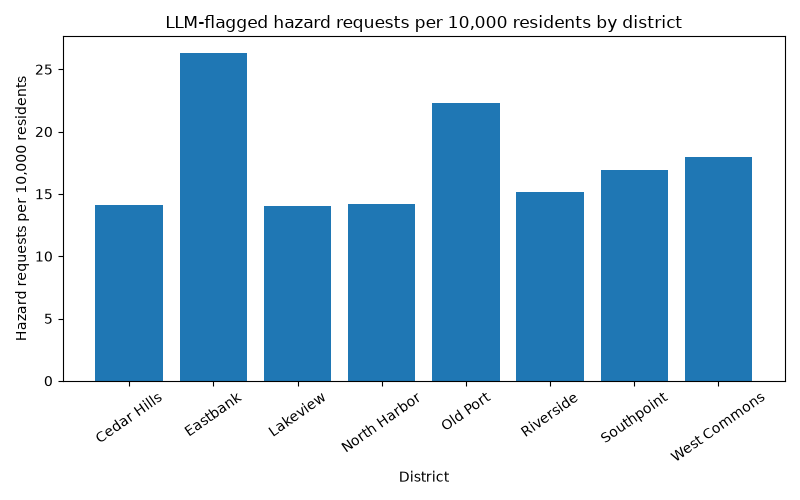
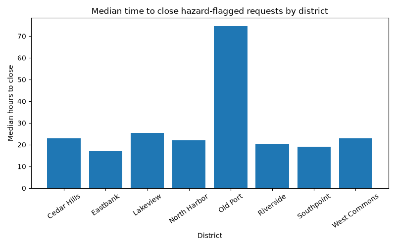

# Potentially Dangerous Infrastructure Incidents: Evidence Review

## 1. Executive Summary

The LLM flags 1,137 of 2,000 requests as hazards, representing 1,131 distinct incidents; validation accuracy for the safety label is 73.0%, so these flags warrant verification rather than being treated as confirmed hazards. Eastbank has the highest population-normalized hazard volume (26.33 requests per 10,000 residents), while 822/1,137 flagged requests carry an intake priority of Routine or Unassigned. Hazard-flagged requests also take longer to close than the LLM-labeled “no” group. Eastbank’s reported volume rises after a mobile reporting rollout, but the timing coincides with channel changes and rainstorms and does not establish a cause.

## 2. Quantitative Results

1. **Overall labels and duplicates.** Of 2,000 requests, 1,137 were labeled safety hazard “yes” (56.85%), 734 “no,” and 129 “unknown.” These represent, respectively, 1,131, 733, and 128 distinct incident IDs. Thus, counting distinct incidents rather than requests reduces the “yes” total by 6; duplicate reports are present and requests should not be read as unique incidents. *Reproduction: grouped requests_enriched by llm_safety_hazard and counted rows and distinct incident_id.*

2. **Geographic concentration.** Eastbank has 237 hazard requests among 388 requests and population 90,000: 26.33 requests per 10,000 residents and a 61.08% within-district request share. It remains the highest district if deduplicated: 233 distinct hazard incidents, or 25.89 per 10,000 residents. Old Port has the largest share of its requests labeled hazard (187/250 = 74.80%), but a lower normalized count rate (22.26 requests per 10,000 residents). *Reproduction: counted hazard requests and divided by district population for the rate; divided hazard requests by all district requests for the share; also counted distinct incident_id.*

   | District | Hazard requests / all requests | Population | Hazard requests per 10,000 residents | Hazard share of requests |
   |---|---:|---:|---:|---:|
   | Eastbank | 237 / 388 | 90,000 | 26.33 | 61.08% |
   | Old Port | 187 / 250 | 84,000 | 22.26 | 74.80% |
   | West Commons | 122 / 200 | 68,000 | 17.94 | 61.00% |
   | Southpoint | 161 / 308 | 95,000 | 16.95 | 52.27% |
   | Riverside | 120 / 227 | 79,000 | 15.19 | 52.86% |
   | North Harbor | 105 / 198 | 74,000 | 14.19 | 53.03% |
   | Cedar Hills | 86 / 187 | 61,000 | 14.10 | 45.99% |
   | Lakeview | 119 / 242 | 85,000 | 14.00 | 49.17% |

3. **Intake priority versus hazard flag.** Among the 1,137 LLM-flagged hazard requests, 822 (72.30%) have intake priority Routine or Unassigned: 759 Routine and 63 Unassigned. The other 315 are High. The cross-tab also shows 530 hazard requests labeled “urgent” by the LLM and 607 labeled “routine” (0 with unknown urgency). *Reproduction: filtered to safety_hazard = yes, counted by intake_priority and llm_urgency, and divided Routine plus Unassigned by all hazard requests.*

4. **Handling time.** Among closed requests, hazard “yes” has mean time to close 62.11 hours and median 23.75 hours (1,132 closed of 1,137); hazard “no” has mean 26.05 and median 13.82 hours (734/734 closed). The separate “unknown” group has mean 45.35 and median 17.50 hours (128/129 closed). *Reproduction: averaged and took the median of non-null hours_to_close within each label; open requests are excluded from these duration statistics.*

   | District | Hazard yes: n closed, mean / median hours | Hazard no: n closed, mean / median hours |
   |---|---:|---:|
   | Cedar Hills | 86, 97.47 / 22.97 | 95, 28.27 / 16.72 |
   | Eastbank | 237, 49.00 / 17.10 | 130, 21.08 / 10.72 |
   | Lakeview | 118, 46.64 / 25.33 | 105, 23.42 / 16.20 |
   | North Harbor | 104, 69.27 / 21.97 | 82, 22.55 / 13.57 |
   | Old Port | 186, 96.73 / 74.65 | 50, 65.52 / 17.32 |
   | Riverside | 119, 35.50 / 20.18 | 94, 23.37 / 13.64 |
   | Southpoint | 160, 42.53 / 18.98 | 116, 22.85 / 12.64 |
   | West Commons | 122, 70.39 / 23.01 | 62, 20.41 / 12.56 |

   Within hazard “yes” requests, High priority has 315 closed requests, mean 92.81 and median 54.60 hours; Routine has 755 closed and 4 open, mean 49.88 and median 19.87 hours; Unassigned has 62 closed and 1 open, mean 55.12 and median 36.20 hours. *Reproduction: grouped hazard requests by intake_priority and calculated mean and median over non-null hours_to_close.*

5. **Time and events in the standout district.** Eastbank recorded 42 hazard requests among 79 total requests in January–April, before the May 1 mobile reporting rollout (10.50 hazard requests per month); from May–December it recorded 195 among 309 requests (24.38 per month). The post-rollout period includes 191 distinct hazard incidents. The hazard share was 53.16% before and 63.11% in the rollout period. Monthly hazard request counts were 10, 12, 5, 15, 33, 30, 27, 28, 19, 21, 19, and 18 from January through December, respectively. *Reproduction: joined events to the district by district_id and compared request created_at before May 1, 2025, with dates from May 1 onward; counted monthly hazard requests and divided period hazard counts by the number of months.*

   Eastbank’s event records include rainstorms on March 23–26, May 12–16 (intensity 5), September 5–8, and September 20–21. The mobile reporting rollout ran May 1–December 31. No staffing expansion or triage workflow update is listed for Eastbank; those events are listed for Riverside (staffing expansion from June 16) and Southpoint (triage update from September 1). Channel mix changes markedly across the Eastbank periods: mobile reports were 3/79 (3.80%) before and 230/309 (74.43%) in the rollout period; phone counts were 39 and 29, web counts 37 and 50. This association makes a reporting-volume change plausible to investigate, but the concurrent rainstorm and reporting changes cannot identify what produced the counts.

## 3. Visualizations

Eastbank has the highest population-normalized hazard request count; the rate is based on requests, with population as denominator.

Eastbank’s monthly series rises in May, the month the mobile rollout began, and remains above the first-quarter monthly counts afterward; counts are not proof of a change in underlying conditions.

Median handling duration varies by district; Old Port is notably higher than the other district medians.

## 4. Classification Analysis

**Intake versus LLM labels.** Intake priority does not consistently surface LLM hazard flags: 759 Routine and 63 Unassigned requests are hazard-flagged (822/1,137, 72.30%). Within the cross-tab, Routine priority includes 517 hazard requests labeled LLM urgency “routine” and 242 labeled “urgent”; Unassigned includes 22 and 41, respectively. High priority includes 68 hazard requests labeled “routine” and 247 “urgent.” These are request counts, not confirmed dangerous incidents.

For intake category versus LLM incident type, literal text comparisons show the largest mismatch counts for Road Maintenance (632/632), General Inquiry (274/274), Streetlight (175/175), and Water Service (145/145). These are **literal mismatches**, not necessarily semantic disagreements: for example, the LLM uses labels such as “road” and “electrical,” which are not exact matches for the intake labels. Drainage has 58 mismatches among 177 requests (32.77%), and Sanitation has 34 among 286 (11.89%). A reviewed crosswalk is needed before interpreting these as classification errors.

**Validation against hand labels.** In the joined validation sample (n = 200), exact-match accuracy is 196/200 (98.0%) for incident type, 194/200 (97.0%) for urgency, and 146/200 (73.0%) for safety hazard. The observed safety-hazard confusion pairs (LLM label → reference label) are: no → no, 65; unknown → no, 4; unknown → unknown, 20; yes → no, 50; and yes → yes, 61. Thus, among the validation examples, many predicted “yes” labels are not “yes” in the reference, while unknown labels also occur. *Reproduction: joined validation_labels to enriched on request_id, counted exact label matches for accuracy, and grouped the safety labels by predicted and reference values.*

## 5. Caveats

- The “unknown” label is material: 129 requests are unknown for safety, and validation includes 20 unknown/unknown pairs and 4 unknown/no pairs. Unknown should remain a separate review category, not be assumed safe or hazardous.
- Safety-label accuracy is 73.0% in the 200-request hand-labeled sample. The sample may not represent every request, and both false-positive and missed-hazard risk remain; LLM flags are not confirmed findings.
- Six requests have no closed_at (2,000 total requests); five are hazard “yes” and one is “unknown.” Open cases have no hours_to_close and are omitted from duration averages and medians, so unresolved cases may change the handling picture.
- District populations differ. The district rate table therefore uses population denominators; request shares answer a different question and should not be used alone to compare hazard burden. Rates are based on population rather than road miles or infrastructure exposure.
- Duplicate reports affect request totals: hazard “yes” is 1,137 requests but 1,131 distinct incident IDs. District and time comparisons can also be affected by duplicates; Eastbank’s monthly incident counts differ from request counts in July and November.
- Reporting channels changed in Eastbank at the same time as the mobile rollout. More submitted requests may reflect access/reporting changes, not necessarily more underlying incidents. Dates also overlap with rainstorms; these are associations, not causal evidence.
- Intake categories and LLM incident-type labels use different vocabularies. Exact-string mismatch rates overstate semantic disagreement unless a category crosswalk is applied. Incomplete or ambiguous descriptions may also limit LLM classification; this analysis does not independently assess description completeness or confirm infrastructure conditions.

## 6. Recommendation

Investigate whether Eastbank’s increased post-May hazard-report volume and the 822 Routine/Unassigned hazard flags reflect missed intake triage, the new mobile reporting channel, storm-related conditions, or a combination. Review a stratified sample of Eastbank reports and their descriptions, intake decisions, field outcomes, and closure records against hand-labeled safety criteria; prioritize the safety-label validation gaps before using LLM flags as operational determinations. This is a follow-up question, not a conclusion about cause.