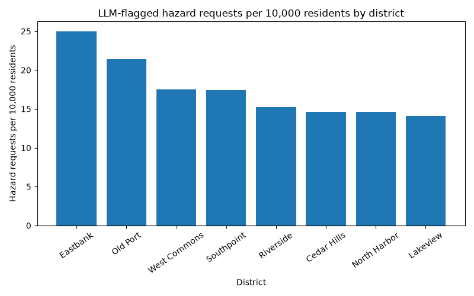
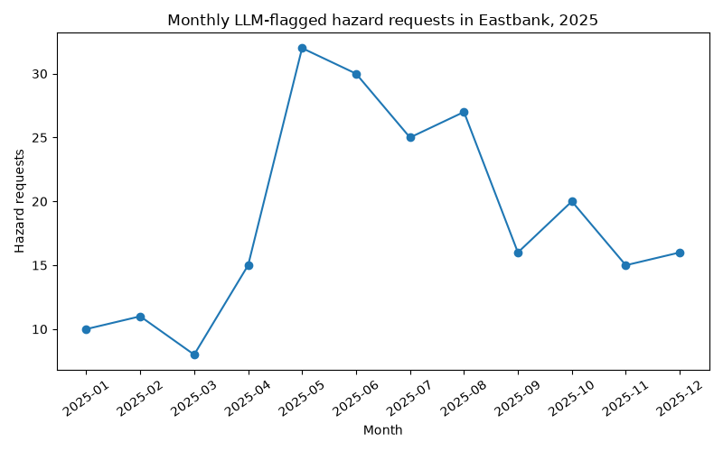
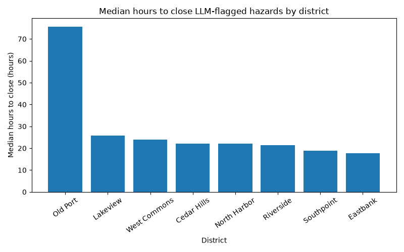

# Potentially Dangerous Infrastructure Incidents: Evidence Review

## 1. Executive Summary

In 2025, the LLM marked **1,127 of 2,000 requests** as safety hazards, representing **1,122 distinct incident IDs**; **126 requests remained unknown**. Eastbank had the highest population-normalized hazard request rate (**25.00 per 10,000 residents**), while Old Port had the highest hazard share of requests (**72.00%**) and the longest hazard median closure time (**75.65 hours**). A substantial intake mismatch merits attention: **812/1,127 flagged hazards (72.05%)** were assigned Routine or Unassigned intake priority. Validation found only **76.00% safety-hazard accuracy** on a 200-request sample, so these patterns are signals for review, not verified incident counts or evidence of cause.

## 2. Quantitative Results

All request analyses cover records dated **2025-01-01 through 2025-12-31**. Counts below are request counts unless explicitly described as distinct incidents.

### Overall labels and duplicates

| LLM safety-hazard label | Requests | Distinct incident IDs |
|---|---:|---:|
| yes | 1,127 | 1,122 |
| no | 747 | 745 |
| unknown | 126 | 125 |

There were **2,000 requests** and **1,986 distinct incident IDs** overall. Deduplicating by incident ID reduces the flagged-hazard figure by **5** (from 1,127 requests to 1,122 incident IDs). Distinct-ID counts are calculated separately within each label, so they are not necessarily a partition of distinct incidents if an incident has differently labelled reports.

### Geography

The per-capita denominator is district population; hazard share uses all requests in that district.

| District | Population | Total requests | Hazard requests | Hazard incidents (distinct IDs) | Hazards per 10,000 residents | Hazard share of district requests |
|---|---:|---:|---:|---:|---:|---:|
| Eastbank | 90,000 | 388 | 225 | 222 | 25.00 | 57.99% |
| Old Port | 84,000 | 250 | 180 | 178 | 21.43 | 72.00% |
| West Commons | 68,000 | 200 | 119 | 119 | 17.50 | 59.50% |
| Southpoint | 95,000 | 308 | 166 | 166 | 17.47 | 53.90% |
| Riverside | 79,000 | 227 | 120 | 120 | 15.19 | 52.86% |
| Cedar Hills | 61,000 | 187 | 89 | 89 | 14.59 | 47.59% |
| North Harbor | 74,000 | 198 | 108 | 108 | 14.59 | 54.55% |
| Lakeview | 85,000 | 242 | 120 | 120 | 14.12 | 49.59% |

Eastbank stands out for the highest normalized rate (**225/90,000 × 10,000 = 25.00**); Old Port stands out on within-district share (**180/250 = 72.00%**). These measure different things and point to different districts for follow-up.

### Intake priority and handling

Of LLM-flagged hazards, **812 of 1,127 (72.05%)** were given intake priority Routine or Unassigned: 750 Routine and 62 Unassigned. The complete hazard/urgency-by-priority cross-tabulation is below; each cell gives request counts by LLM hazard label and urgency.

| Intake priority | LLM hazard label | LLM urgency: routine | urgent | unknown | Total |
|---|---|---:|---:|---:|---:|
| High | yes | 71 | 244 | 0 | 315 |
| High | no | 83 | 15 | 0 | 98 |
| High | unknown | 2 | 0 | 7 | 9 |
| Routine | yes | 506 | 244 | 0 | 750 |
| Routine | no | 593 | 16 | 0 | 609 |
| Routine | unknown | 22 | 0 | 62 | 84 |
| Unassigned | yes | 25 | 37 | 0 | 62 |
| Unassigned | no | 40 | 0 | 0 | 40 |
| Unassigned | unknown | 0 | 0 | 33 | 33 |

Closure durations below use requests with a non-null `hours_to_close`; n is the number of closed requests. Unknown hazard labels are kept separate from “no.”

| LLM hazard label | Requests | Closed n | Average hours to close | Median hours to close |
|---|---:|---:|---:|---:|
| yes | 1,127 | 1,122 | 59.06 | 23.99 |
| no | 747 | 747 | 30.73 | 13.62 |
| unknown | 126 | 125 | 48.22 | 17.50 |

District closure results (each duration cell is average / median hours; n is closed requests):

| District | yes n; avg / median | no n; avg / median | unknown n; avg / median |
|---|---:|---:|---:|
| Cedar Hills | 89; 57.91 / 22.10 | 92; 64.18 / 16.58 | 6; 13.26 / 12.22 |
| Eastbank | 225; 49.12 / 17.72 | 139; 23.58 / 10.47 | 24; 18.03 / 8.45 |
| Lakeview | 119; 45.67 / 25.72 | 104; 24.19 / 15.43 | 18; 21.44 / 18.33 |
| North Harbor | 107; 67.74 / 22.03 | 83; 22.65 / 13.75 | 7; 29.90 / 17.32 |
| Old Port | 179; 99.59 / 75.65 | 55; 60.55 / 17.20 | 15; 204.27 / 63.12 |
| Riverside | 119; 36.08 / 21.48 | 94; 22.86 / 14.07 | 13; 25.32 / 21.38 |
| Southpoint | 165; 41.76 / 18.80 | 113; 22.38 / 11.75 | 28; 40.12 / 15.16 |
| West Commons | 119; 70.26 / 24.02 | 67; 20.38 / 13.42 | 14; 28.81 / 17.48 |

Among hazards, closure by intake priority was: High, **n=315**, average **82.11** hours, median **54.02**; Routine, **n=746**, average **49.59**, median **20.11**; Unassigned, **n=61**, average **55.71**, median **36.47**. These are descriptive differences, not evidence that priority caused closure time.

### Time and events

Monthly hazard-request counts, in calendar-month order, were:

| Month (2025) | Citywide hazards | Eastbank hazards |
|---|---:|---:|
| Jan | 78 | 10 |
| Feb | 71 | 11 |
| Mar | 78 | 8 |
| Apr | 103 | 15 |
| May | 107 | 32 |
| Jun | 113 | 30 |
| Jul | 110 | 25 |
| Aug | 107 | 27 |
| Sep | 88 | 16 |
| Oct | 86 | 20 |
| Nov | 86 | 15 |
| Dec | 100 | 16 |

Eastbank’s monthly hazard counts rose from **15 in April to 32 in May**. The events table records an Eastbank (`D02`) mobile reporting rollout from **May 1 through December 31**, a major rainstorm **May 12–16**, and other rainstorms **March 23–26**, **September 5–8**, and **September 20–21**. The timing overlaps, and cannot distinguish an operational/reporting change from changes in underlying incidents.

For a before/after descriptive comparison, Eastbank had **79 total requests and 44 flagged hazards during January–April**, versus **309 requests and 181 flagged hazards during May–December**. The periods span different numbers of months. Channel mix changed alongside the rollout: Mobile/Web/Phone counts were **3/37/39 before**, and **230/50/29 during** the rollout period. Thus the increased request volume is associated with the availability and use of the mobile channel; these data do not establish why reporting changed. Mobile requests in Eastbank had a **63.52%** hazard share (**148/233**), compared with Web **49.43% (43/87)** and Phone **50.00% (34/68)**; channel differences may also reflect what people report through each channel.

The events table also records a Staffing Expansion in district `D05` from **June 16 through December 31** and a Triage Workflow Update in `D06` from **September 1 through December 31**. Neither is recorded for Eastbank (`D02`).

## 3. Visualizations

Eastbank has the highest population-normalized hazard-request rate; this chart uses district population as the denominator.

Monthly Eastbank request counts show a peak in May, the month the mobile reporting rollout began.

This chart compares median closure times for closed, LLM-flagged hazard requests, with Old Port highest.

## 4. Classification Analysis

### Intake versus LLM labels

For intake-category comparison, the reproducible correspondence used was: Road Maintenance→road, Drainage→drainage, General Inquiry and Other→other, Sanitation→sanitation, Streetlight→electrical, Traffic Signal→traffic_signal, Tree Maintenance→tree, and Water Service→water. “Disagreement” means the LLM incident type differed from this mapped category; `unknown` is counted as a disagreement. On this basis:

| Intake category | Requests | Disagreements | Disagreement share |
|---|---:|---:|---:|
| General Inquiry | 274 | 134 | 48.91% |
| Road Maintenance | 632 | 121 | 19.15% |
| Other | 126 | 110 | 87.30% |
| Drainage | 177 | 57 | 32.20% |
| Sanitation | 286 | 36 | 12.59% |
| Streetlight | 175 | 24 | 13.71% |
| Water Service | 145 | 17 | 11.72% |
| Traffic Signal | 59 | 10 | 16.95% |
| Tree Maintenance | 126 | 10 | 7.94% |

General Inquiry had the largest number of mismatches; Other had the largest mismatch share. These results depend on the stated crosswalk, particularly for broad intake categories.

### Validation sample

Joining `validation_labels` to `enriched` by `request_id` gives **200** reference-labelled requests. Exact-match accuracy was:

| Label | Correct / validation rows | Accuracy |
|---|---:|---:|
| Incident type | 197 / 200 | 98.50% |
| Urgency | 196 / 200 | 98.00% |
| Safety hazard | 152 / 200 | 76.00% |

Safety-hazard confusion counts (reference label by LLM label):

| Reference | LLM no | LLM unknown | LLM yes |
|---|---:|---:|---:|
| no | 71 | 2 | 46 |
| unknown | 0 | 20 | 0 |
| yes | 0 | 0 | 61 |

In this sample, 46 reference “no” cases were labelled “yes,” while 20 reference “unknown” cases were also labelled unknown. This reinforces that the hazard count should be treated as an imperfect classification, not ground truth.

## 5. Caveats

- **Unknown labels:** 126 requests (125 distinct incident IDs) have `safety_hazard='unknown'`; they are not treated as either hazards or non-hazards here. Unknown urgency also appears in the priority cross-tab.
- **LLM error:** Safety-hazard accuracy was 76.00% on the 200-request validation sample, lower than incident-type and urgency accuracy. The sample may not represent all requests, and false positives/negatives can alter district and handling comparisons.
- **Open requests:** `hours_to_close` is null for **6** requests: **5** hazard-yes and **1** unknown. Closure-time summaries therefore describe closed requests only and may exclude unresolved cases.
- **Different population sizes:** District counts are not directly comparable as risk levels; the per-10,000 rates use district populations. Population-normalized reporting rates still do not measure infrastructure exposure or severity.
- **Duplicates:** There are **2,000** request rows but **1,986** distinct incident IDs. For hazard-yes, counting distinct incident IDs changes the result from **1,127** requests to **1,122** incidents. Repeat reports can inflate request counts; incident IDs may also group reports whose labels differ.
- **Reporting and workflow changes:** Eastbank’s mobile rollout coincides with a changed channel mix and higher request volume. Rainstorms also overlap some months. Staffing expansion and triage update events are recorded in other district IDs. These time-aligned associations do not show that any event caused changes in hazard volume or closure time.
- **Descriptions and intake labels:** Intake categories and priorities are known to be imperfect, and LLM-derived labels rely on request information. Incomplete or ambiguous descriptions can affect both automated classification and validation comparisons. Intake-to-LLM disagreement is not, by itself, proof either label is wrong.

## 6. Recommendation

Investigate whether Eastbank’s increase in flagged requests after the May mobile rollout reflects additional reporting, a change in incident mix, or both. Review a sample of Eastbank mobile submissions from before and after the rollout against the original descriptions and field inspections, and audit whether high-risk cases receive consistent triage—especially because Routine or Unassigned priority accounts for **812/1,127 (72.05%)** of all LLM-flagged hazards citywide. Treat this as a targeted audit question, not a conclusion that the rollout or intake process caused the observed patterns.