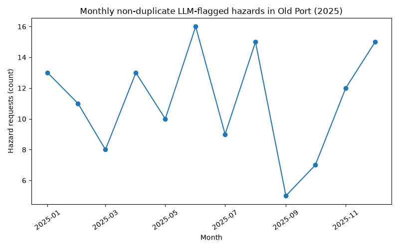
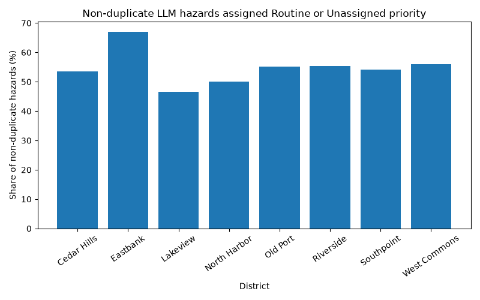

# Potentially Dangerous Infrastructure Incidents: Evidence Review

## 1. Executive Summary

The LLM flagged 547 safety hazards among 2,000 requests, including 497 non-duplicates; Old Port stood out at 15.95 non-duplicate hazard requests per 10,000 residents, and intake priority was Routine or Unassigned for 277/497 (55.73%) non-duplicate hazards, including 203 that the LLM also marked urgent. Hazards took longer to close than non-hazards among closed requests, while validation on 200 labelled requests showed 97.5% safety-hazard accuracy and five missed reference-positive hazards; these findings identify triage and geographic patterns for investigation, not proven causes.

## 2. Quantitative Results

1. **Safety-hazard labels and duplicates.** Across all 2,000 requests, the LLM marked 547 `yes`, 1,350 `no`, and 103 `unknown`. Excluding rows marked `is_duplicate`, counts were 497 `yes`, 1,228 `no`, and 91 `unknown`. There were 50 duplicate requests labelled hazard `yes`. Computation: count requests by `llm_safety_hazard`, repeating counts with `NOT is_duplicate`; count hazard duplicates with `is_duplicate` and hazard `yes`.

2. **Geographic distribution.** Hazard request rates use district population as denominator; hazard shares use that district's total requests (all rows or non-duplicates, respectively). Old Port ranked highest both including and excluding duplicates.

| District | Population | Requests, all | Hazards, all | Rate/10,000, all | Hazard share, all | Requests, non-duplicate | Hazards, non-duplicate | Rate/10,000, non-duplicate | Hazard share, non-duplicate |
|---|---:|---:|---:|---:|---:|---:|---:|---:|---:|
| Old Port | 84,000 | 250 | 142 | 16.90 | 56.80% | 240 | 134 | 15.95 | 55.83% |
| Eastbank | 90,000 | 388 | 107 | 11.89 | 27.58% | 289 | 82 | 9.11 | 28.37% |
| West Commons | 68,000 | 200 | 50 | 7.35 | 25.00% | 195 | 50 | 7.35 | 25.64% |
| North Harbor | 74,000 | 198 | 50 | 6.76 | 25.25% | 194 | 50 | 6.76 | 25.77% |
| Southpoint | 95,000 | 308 | 74 | 7.79 | 24.03% | 263 | 61 | 6.42 | 23.19% |
| Riverside | 79,000 | 227 | 48 | 6.08 | 21.15% | 218 | 47 | 5.95 | 21.56% |
| Lakeview | 85,000 | 242 | 46 | 5.41 | 19.01% | 234 | 45 | 5.29 | 19.23% |
| Cedar Hills | 61,000 | 187 | 30 | 4.92 | 16.04% | 183 | 28 | 4.59 | 15.30% |

   Computation: group by district, count LLM `yes` hazards and all district requests, repeat after excluding duplicates, divide hazard counts by the reported district population for rates and by district request counts for shares. The high Old Port rate is a district-level standout, not a population-adjusted measure of incident severity.

3. **Hazard handling and closure times.** Among closed requests classified `yes` or `no`, hazards (543 closed requests) averaged 88.03 hours to close (median 62.43), versus 32.06 hours (median 15.32) for 1,349 closed non-hazards. For hazards by intake priority, closed counts, average hours, and median hours were: High, 243 / 96.44 / 70.08; Routine, 265 / 81.73 / 50.10; Unassigned, 35 / 77.24 / 62.67. These are descriptive comparisons of closed requests only.

4. **Monthly pattern and local event dates.** Old Port's non-duplicate hazard counts by month in 2025 were Jan 13, Feb 11, Mar 8, Apr 13, May 10, Jun 16, Jul 9, Aug 15, Sep 5, Oct 7, Nov 12, and Dec 15. The monthly minimum was 5 in September and maximum 16 in June. Matching requests to Old Port (district D04) event dates, event-covered dates with requests had 21 requests and 10 non-duplicate hazards across 15 request-active days (1.40 requests and 0.67 hazards per such day); dates outside event windows had 229 requests and 124 hazards across 163 request-active days (1.40 requests and 0.76 hazards per such day). Old Port's recorded events included construction, rainstorms, cold snaps, transit disruption, and a community event; its event records did not include a mobile reporting rollout, staffing expansion, or triage workflow update. This event-date comparison is descriptive and does not establish an event effect.

## 3. Visualizations

This compares population-normalized hazard request rates across districts, excluding duplicate requests; Old Port is highest.

This shows the month-to-month count variation in Old Port during 2025, excluding duplicates.

This shows, within each district's non-duplicate LLM hazards, the share assigned Routine or Unassigned intake priority.

## 4. Classification Analysis

### Intake priority versus LLM hazard and urgency

The following cross-tab reports non-duplicate requests. For `yes` and `no`, each cell gives `routine / urgent`; for LLM hazard `unknown`, it gives `routine / unknown` urgency.

| Intake priority | LLM hazard yes (routine / urgent) | LLM hazard no (routine / urgent) | LLM hazard unknown (routine / unknown urgency) |
|---|---:|---:|---:|
| High | 9 / 211 | 137 / 20 | 0 / 7 |
| Routine | 72 / 172 | 990 / 20 | 1 / 54 |
| Unassigned | 2 / 31 | 60 / 1 | 0 / 29 |

Among non-duplicate LLM-flagged hazards, 277/497 (55.73%) had intake priority Routine or Unassigned; 203/277 (73.29%) of those were also labelled `urgent` by the LLM. Eastbank had the largest district share: 55/82 (67.07%) of its non-duplicate hazards were Routine or Unassigned, including 35 LLM-urgent requests. These are discrepancies between intake-priority labels and LLM assessments, not evidence that a particular case was mishandled.

### Mapped intake category versus LLM incident type

Agreement compares `intake_category_mapped` with `llm_incident_type` (not the unmapped original category). Overall agreement was 1,487/2,000 (74.35%).

| Mapped intake category | Agreements / requests | Agreement |
|---|---:|---:|
| road | 516 / 632 | 81.65% |
| other | 150 / 400 | 37.50% |
| sanitation | 258 / 286 | 90.21% |
| drainage | 119 / 177 | 67.23% |
| electrical | 151 / 175 | 86.29% |
| water | 128 / 145 | 88.28% |
| tree | 116 / 126 | 92.06% |
| traffic_signal | 49 / 59 | 83.05% |

The most frequent disagreement pairs were `other` → `road` (72), `other` → `sanitation` (47), `other` → `unknown` (39), `drainage` → `road` (39), and `other` → `electrical` (32).

### Validation-label results

Joining the 200 validation labels to `requests_enriched` on `request_id`, accuracy was 194/200 (97.00%) for incident type, 196/200 (98.00%) for urgency, and 195/200 (97.50%) for safety hazard.

| Reference safety hazard | LLM yes | LLM no | LLM unknown |
|---|---:|---:|---:|
| yes | 56 | 5 | 0 |
| no | 0 | 119 | 0 |
| unknown | 0 | 0 | 20 |

LLM-yes precision was 56/56 (100.00%) in this validation sample. The observed safety-hazard errors were five reference `yes` labels classified by the LLM as `no`; there were no LLM `yes` labels against reference `no` or `unknown` in this sample.

## 5. Caveats

- `Unknown` labels are distinct from `yes` and `no`: 103/2,000 requests had unknown safety-hazard labels, and 91 remained unknown after excluding duplicates. The LLM labels are not ground truth.
- Validation indicates under-flagging in this sample: five reference-positive hazards were labelled `no`, while no false-positive LLM `yes` labels appeared among the 200 reviewed requests. The 100.00% precision estimate is based on 56 LLM-yes cases in that sample, not a guarantee of citywide performance.
- The classification prompt was revised after validation mismatches were reviewed, so the reported validation accuracy may be optimistic.
- Six of 2,000 requests have no `closed_at` and no `hours_to_close`; they are not represented in the closed-request handling averages and medians.
- District populations differ, so raw counts alone are not comparable; rates here use the population values joined to the request records. Population normalization does not adjust for infrastructure exposure or reporting propensity.
- Duplicate requests are included in the all-request results and excluded in the stated non-duplicate comparisons; `is_duplicate` (closure reason Duplicate) is the duplicate marker.
- Reporting channels and outreach or operational events can change recorded volume without a change in underlying conditions. Old Port received phone (126 requests), web (114), and mobile (10) reports during the year, with each channel represented in January–December date ranges; the recorded mobile channel was not a new mid-year channel in this district. The mobile reporting rollout instead applied to Eastbank from 2025-05-01 through 2025-12-31; staffing expansion applied to Riverside from 2025-06-16, and a triage workflow update to district D06 from 2025-09-01. These district-specific changes should not be treated as causal explanations for Old Port's pattern.
- Descriptions can be incomplete or vague, limiting both LLM classification and interpretation of apparent disagreements. Event-date comparisons are associations, not causal tests.

## 6. Recommendation

Investigate whether Eastbank's intake-priority assignment for LLM-flagged hazards is associated with a distinct triage process: 55/82 (67.07%) non-duplicate hazards there were labelled Routine or Unassigned, the highest district share, and 35 of those 55 were also LLM-labelled urgent. This is a focused association to examine, not evidence that the priority assignment caused delay or harm.